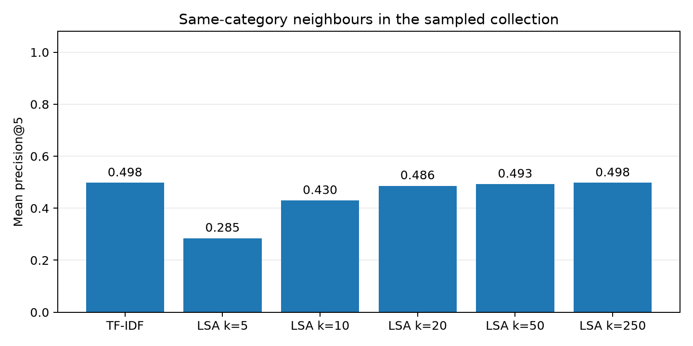

# SVD Subtext

**Document similarity with a custom Gram-matrix SVD, TF-IDF and latent semantic analysis (LSA).**

An individual project for **MAC F211 — Linear Algebra and Its Applications**, BITS Pilani, Goa Campus, by **Pranjal Kumar**. The project connects the mathematics of singular value decomposition with a working text-processing pipeline and evaluates how truncation changes document similarity.

The core SVD is constructed using NumPy array operations and `numpy.linalg.eigh`. NumPy's direct SVD is used only as a reference in tests. Scikit-learn supplies the 20 Newsgroups dataset; it does not compute the project's TF-IDF matrix or LSA representation.

## What is implemented

- A compact SVD for real, finite, tall, wide, rank-deficient and zero matrices.
- Selection of the smaller Gram matrix, input scaling, numerical-rank filtering and consistent paired signs for singular vectors.
- TXT loading, cleaning, tokenisation, count matrices and TF-IDF weighting.
- Explicit or energy-based rank selection, LSA document coordinates and pairwise cosine similarity.
- Reconstruction, orthogonality, retained-energy and condition-number diagnostics.
- Two synthetic case studies and a labelled 250-document experiment from 20 Newsgroups.
- Automated tests, experiment scripts, saved numerical results and plots.

## Method

1. Load `.txt` files in filename order using UTF-8 with optional BOM handling.
2. Remove URLs and email addresses, replace punctuation with spaces, lowercase the text and extract `[a-z]+` tokens.
3. Build a **terms × documents** count matrix. Vocabulary rows are sorted alphabetically.
4. Weight each term using raw-count TF and the following IDF:

   $$A_{ij}=C_{ij}\left(1+\ln\frac{N}{\mathrm{df}_i}\right).$$

5. Scale the matrix, form the smaller of $B^\top B$ and $BB^\top$, and solve its symmetric eigenvalue problem using `eigh`. Recover the other singular-vector factor and restore the singular-value scale.
6. Retain $k$ components and represent document columns by:

   $$Z_k=\Sigma_kV_k^\top.$$

7. Compare cosine similarities in the original TF-IDF space and the reduced LSA space.

There is no stop-word removal, stemming, lemmatisation, pretrained embedding model or column normalisation before SVD. Cosine computation normalises document vectors when comparing them. By default, rank selection retains at least 90% of the squared singular-value energy in the numerical spectrum.

Keeping the full numerical rank should preserve TF-IDF cosines up to numerical error. Truncating the representation does **not** guarantee better retrieval.

## Setup

Run all commands from the repository root. The supplied Conda environment specifies Python 3.13.

```bash
git clone https://github.com/pranjalkumar0001/SVD_subtext.git
cd SVD_subtext
conda env create -f environment.yml
conda activate svd-project
```

Alternatively, use Python 3.13 in a virtual environment:

```bash
python -m venv .venv
```

Activate it with `source .venv/bin/activate` on macOS/Linux, or `.venv\Scripts\Activate.ps1` in Windows PowerShell, then install dependencies:

```bash
python -m pip install -r requirements.txt
```

## Compare documents

```bash
# Choose rank automatically using the default 90% energy target
python -m src.main Data/Samples

# Choose the retained rank explicitly
python -m src.main Data/LongSamples --k 3

# Change the energy target
python -m src.main Data/LongSamples --energy 0.95

# Also print the vocabulary and its matrix row indices
python -m src.main Data/Samples --show-vocab

# Use your own collection
python -m src.main "path/to/documents" --k 3
```

Supply at least two TXT documents. The CLI prints document and vocabulary counts, numerical rank, selected rank, retained energy, retained condition number and the TF-IDF/LSA cosine for each distinct document pair. An explicit `--k` overrides automatic energy selection and must be between 1 and the numerical rank. Zero document vectors are rejected because their cosine is undefined.

## Experiments

| Experiment | Collection | Run command | Output directory |
|---|---|---|---|
| Short passages | Five synthetic documents about coffee, outdoor activities and music | `python -m experiments.experiment1` | `figures/experiment1/` |
| Longer passages | Five synthetic administrative documents about shuttles, archives and club treasury work | `python -m experiments.experiment2` | `figures/experiment2/` |
| Labelled evaluation | 250 sampled 20 Newsgroups documents from five categories | `python -m experiments.experiment_big` | `figures/experiment_big/` |

The first two scripts save `results.json`, singular-spectrum/energy plots, similarity heatmaps and two-dimensional LSA plots. These small synthetic collections illustrate behaviour rather than establish general retrieval performance.

The large experiment downloads the dataset on its first run, so it requires internet access. It uses the by-date **training subset**, removes headers, footers and quotes, and samples 50 documents per category with seed 42 after requiring at least 30 cleaned tokens. Categories are `comp.graphics`, `rec.autos`, `rec.sport.baseball`, `sci.med` and `sci.space`.

Selected texts are written to `Data/20newsgroups/documents/`, with labels in `Data/20newsgroups/labels.csv`. The source dataset is cached under `.cache/20newsgroups/`. These downloaded data are not included in the repository. Change experiment settings through the constants in `experiments/experiment_big.py`; if changing the sample, move the existing generated document folder aside first. The script rejects unexpected files rather than silently mixing samples.

### Recorded 20 Newsgroups results

The committed [results.json](figures/experiment_big/results.json) records a **6,479 × 250** TF-IDF matrix with numerical rank **250**.

| Representation | Mean precision@5 | Retained spectral energy |
|---|---:|---:|
| TF-IDF | **0.4976** | — |
| LSA, rank 5 | 0.2848 | 38.80% |
| LSA, rank 10 | 0.4296 | 49.16% |
| LSA, rank 20 | 0.4864 | 61.14% |
| LSA, rank 50 | 0.4928 | 76.89% |
| LSA, rank 250 | **0.4976** | 100.00% |



For each document, precision@5 is the fraction of its five highest-cosine **other** documents with the same category label. Self-matches are excluded; exact ties follow document order. The reported mean averages over all 250 documents. The retrieval cutoff of five neighbours is separate from the retained SVD rank.

**On this sample, none of the tested reduced ranks beats TF-IDF.** Rank 50 comes within 0.0048 of the baseline while using 50 coordinates per document; full-rank LSA reproduces the baseline. This does not establish a runtime or memory improvement for the complete pipeline, which still constructs dense matrices and computes the numerical SVD.

The recorded relative reconstruction error is approximately **1.88 × 10⁻¹⁵**, and the maximum full-rank cosine difference is **2.23 × 10⁻¹⁴**. The JSON also stores per-category and per-document precision, sampled filenames, input SHA-256 hashes and package versions.

These are **within-collection neighbour results**, not held-out classification accuracy or a held-out query retrieval benchmark. TF-IDF and SVD are fitted to the same collection being searched, and category equality is used as a proxy for relevance. Results describe this fixed sample and preprocessing configuration; they do not demonstrate a general LSA advantage.

## Tests

```bash
python -m pytest -q
```

Tests cover loading and ordering, text cleaning and tokenisation, count matrices and TF-IDF, SVD reconstruction and orthogonality, comparison against NumPy reference singular values, similarity and rank selection, and precision@k behaviour including self-exclusion, negative scores, ties and invalid inputs.

The tests do not download the 20 Newsgroups dataset, although importing its experiment module requires scikit-learn and Matplotlib to be installed.

## Repository guide

| Path | Purpose |
|---|---|
| `src/data_loader.py` | TXT input and filename ordering |
| `src/preprocessing.py` | Cleaning, tokens, counts and TF-IDF |
| `src/SVD.py` | Compact SVD from the smaller Gram matrix |
| `src/similarity.py` | Rank selection, embeddings, cosines and conditioning |
| `src/main.py` | Command-line application |
| `experiments/` | Three reproducible experiment scripts |
| `tests/` | Automated tests |
| `Data/Samples/`, `Data/LongSamples/` | Included synthetic collections |
| `figures/` | Committed plots and numerical results |
| `report/` | Mathematical report in LaTeX and PDF |

## Report and limitations

The [report PDF](report/svd_report.pdf) and [LaTeX source](report/svd_report.tex) develop the SVD mathematics and the two synthetic case studies. The report currently predates the completed 20 Newsgroups evaluation; use the experiment script and saved results for that extension.

- Forming a Gram matrix reduces accuracy for small singular values. The numerical-rank threshold is a practical heuristic, not an exact error bound.
- Dense term-document and pairwise-similarity matrices limit scalability.
- Bag-of-words features discard word order; the ASCII tokenizer does not provide multilingual linguistic processing.
- High retained spectral energy measures reconstruction fidelity, not retrieval quality.
- The project is a mathematical implementation and evaluation exercise, not a replacement for production SVD libraries or a pretrained semantic search system.

## License

This project's code is licensed under the [MIT License](LICENSE).
Third-party dependencies and datasets retain their respective licences and terms.